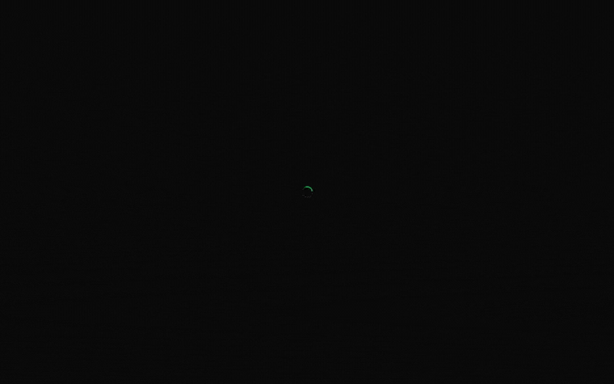
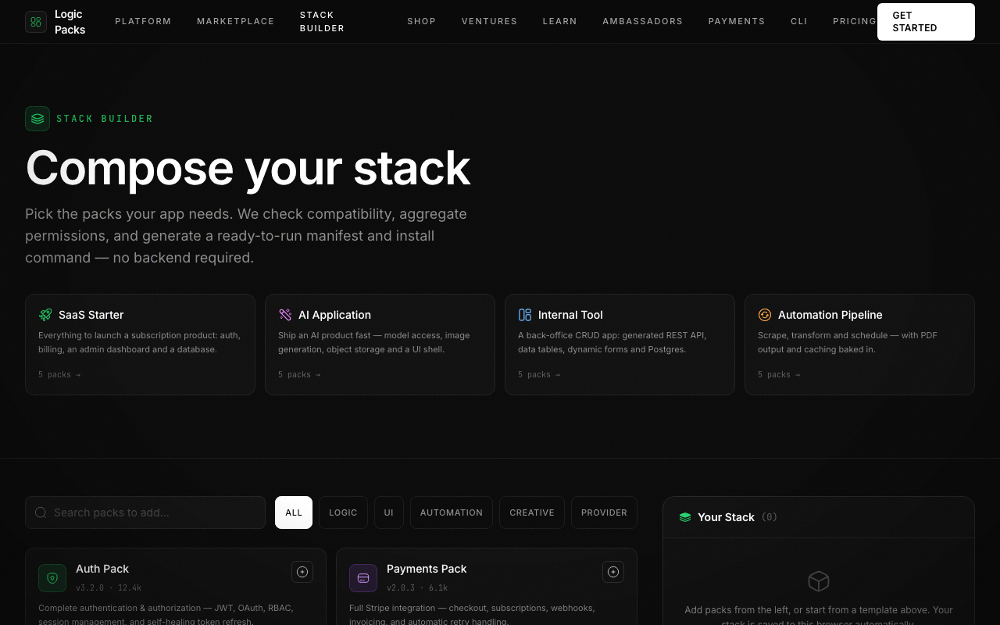
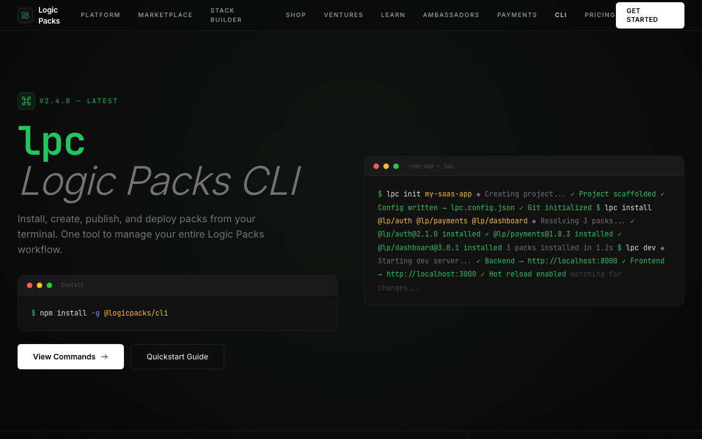
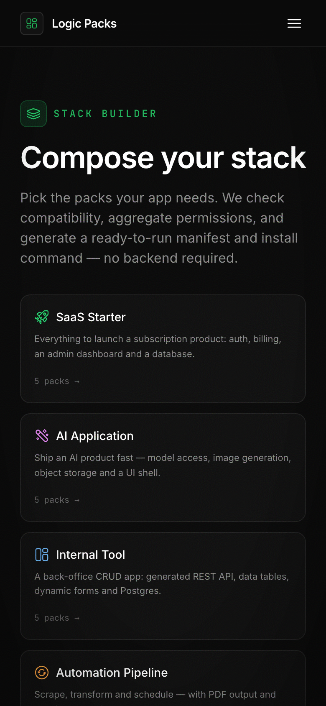

# Logic Packs — Build Once, Reuse Everywhere

<p align="center">
  <a href="https://logicpacks.io"></a>
  
  
  
  
  
</p>

> The operating system for reusable software. Browse a marketplace of verified feature
> **packs** — payments, auth, AI, dashboards, chatbots, email — and drop them into any app
> like installing an app on your phone. This repo is the **marketing + storefront landing
> site**: a fast, dark, motion-heavy React experience with a live Three.js hero, a
> compose-your-own **Stack Builder**, and a private-beta gate.

<p align="center">
  
</p>

<p align="center"><em>Home → Marketplace → Stack Builder → CLI, in one breath. No coffee break required.</em></p>

Built with React 18 + Vite, styled with Tailwind, animated with GSAP, and fronted by a
5,000-particle Three.js sphere that explodes on scroll and reassembles on click. No backend,
no database — every pack, product and price lives in typed data modules, so the whole thing
ships as static files and loads in a blink. Pack it up, ship it anywhere. 📦

---

## 🆕 What's new in this release

This round turned the landing site from "pretty brochure" into "living product". Highlights:

### 🧱 Stack Builder — compose your own stack (`/stack`)
The headline addition. Pick the packs your app needs and Logic Packs **checks compatibility,
aggregates the permissions each pack requests, and generates a ready-to-run manifest + install
command** — entirely client-side, no backend. Start from a curated template (SaaS Starter, AI
Application, Internal Tool, Automation Pipeline) or search the catalog and build from scratch.
Your stack is saved to the browser, so a refresh never loses your work.

<p align="center">
  
</p>

### 🎛️ A/B hero variant + CLI output modes
- **`?variant=b`** swaps the marketplace hero for an alternate **search-first** layout — flip
  it live to compare the two without a rebuild.
- The **CLI page** now renders its command output in multiple **modes** (pretty / plain / JSON)
  plus a **light terminal theme**, so you can see exactly what `lpc` prints in your environment.
- Details and the reasoning live in [`docs/VARIANTS.md`](docs/VARIANTS.md).

### ♿ Accessibility + performance
- **Skip-to-content link**, ARIA landmarks and roles, and a consistent keyboard **focus ring**
  (`:focus-visible`, mouse clicks stay ring-free).
- **`prefers-reduced-motion`** is honoured everywhere — the marquee, typing, cube and bar
  animations calm down, and the Three.js hero swaps to a static orb.
- The heavy Three.js hero is now **lazy-loaded** behind a matching placeholder, keeping ~120 kB
  of WebGL off the home page's critical path so the copy and CTA paint instantly.
- **44px touch targets** on coarse pointers for comfortable tapping.

### 🛡️ Robustness
- **WebGL fallback** — no GPU, a blocked context, or a mid-session **context loss** all fall back
  to a hand-built static orb instead of a black hole.
- **Hardened mobile nav** — a proper 44px toggle, a scrollable menu that caps at the viewport
  height (every link reachable in landscape), and an in-menu "Get Started" CTA.

### ✨ UI polish
- A **scroll-progress bar**, a **back-to-top** ring button, an **ambient texture** layer for depth,
  **spotlight** hover cards, and real **loading skeletons + empty states** on the marketplace.

### 🧪 Tests + CI
- A **Vitest** unit suite (**47 tests** across the access gate, beta modal, catalog helpers and
  data integrity) plus a **Playwright** e2e smoke spec, wired into **GitHub Actions**. See
  [`TESTING.md`](TESTING.md).

<p align="center">
  
  
</p>

---

## ✨ The rest of the site

- **Persona-aware home** — a "What brings you here?" chooser routes visitors to the view that
  matters to them: `marketplace` (buyers), `founder` (startups/VCs), or `developer` (pack
  builders). Each persona gets its own tailored landing page.
- **Live Three.js hero** — an icosahedron core + wireframe shell + particle field with bloom
  post-processing. Scroll to explode it, click to reassemble. It's the good kind of showing off.
- **A full storefront** — packs marketplace (`/store`), physical shop (`/shop`), pack &
  product detail pages, a CLI product page, plus audience pages for ventures, founders,
  investors, ambassadors and courses.
- **Private-beta access gate** — a slick 13-character code screen guards the site (see
  [Getting past the gate](#-getting-past-the-gate)). Access is remembered per session.
- **Beta signup modal** — a global context (`useBeta()`) any component can pop open.
- **Custom 404** — unknown routes land on a themed "this pack didn't compile" page.
- **Genuinely responsive** — every page is tuned from 390px phones up to widescreen.

---

## 🚀 Quick start (from zero)

You'll need **Node.js 18 or newer** and npm (npm ships with Node). Not sure if you have it?

```bash
node -v   # should print v18.x.x or higher
npm -v    # any recent version is fine
```

Don't have Node? Grab the LTS installer from [nodejs.org](https://nodejs.org/), or use a
version manager like [nvm](https://github.com/nvm-sh/nvm).

Then, three copy-paste commands and you're live:

```bash
# 1. Clone it
git clone https://github.com/waleedsworld/logicpacks-landingpage.git
cd logicpacks-landingpage

# 2. Install dependencies
npm install

# 3. Start the dev server (opens http://localhost:3000 automatically)
npm run dev
```

That's it — you're running Logic Packs locally. 🎉

### Building for production

```bash
npm run build     # outputs an optimized static bundle to dist/
npm run preview   # serve that build locally to double-check it
```

The `dist/` folder is 100% static — drop it on any static host (Cloudflare Pages, Netlify,
Vercel, GitHub Pages, an S3 bucket, whatever you fancy). A `public/_redirects` rule
(`/* /index.html 200`) ships with it so client-side routes resolve on direct navigation.

### Running the tests

```bash
npm test          # Vitest unit suite (47 tests)
npm run test:e2e  # Playwright end-to-end smoke test
npm run test:all  # both
```

---

## 🔐 Getting past the gate

The site opens on a private-beta access screen. The demo access code is:

```
buildanything
```

Type it into the 13 boxes (it auto-submits and plays a little unlock animation) and you're in.
Access is stored in `sessionStorage`, so it sticks until you close the tab. The code lives in
`src/components/AccessGate.jsx` if you want to change it or rip the gate out entirely.

<p align="center">
  
</p>

---

## 🧭 Project map

```
src/
├─ main.jsx              # entry — BrowserRouter + scroll reset
├─ App.jsx              # routes (lazy-loaded) wrapped in AccessGate + BetaProvider
├─ index.css            # design tokens, keyframes, reduced-motion + focus rules
├─ components/
│  ├─ AccessGate.jsx    # private-beta code screen
│  ├─ HeroScene.jsx     # the Three.js sphere + particle explosion (+ StaticOrb fallback)
│  ├─ HeroCanvas.jsx    # lazy Suspense wrapper that keeps Three.js off the critical path
│  ├─ HeroVariantB.jsx  # alternate search-first hero (?variant=b)
│  ├─ CommandOutputModes.jsx  # CLI output mode switcher (pretty / plain / JSON)
│  ├─ BetaModal.jsx     # global beta-signup context + modal
│  ├─ ScrollProgress / BackToTop / AmbientTexture / PackCardSkeleton   # UI polish
│  ├─ Header / Footer / Layout / ScrollReveal / Terminal / ErrorBoundary
├─ hooks/
│  ├─ useStack.js        # Stack Builder state (add/remove packs, persisted)
│  └─ useReducedMotion.js
├─ lib/catalog.js        # catalog helpers (unit-tested)
├─ pages/               # one file per route (Home, Store, Shop, CLI, StackBuilder, …, NotFound)
└─ data/
   ├─ packs.js          # PACKS, TYPE_LABELS, TYPE_COLORS
   ├─ products.js       # PRODUCTS, PRODUCT_CATEGORIES
   ├─ packDetails.js    # extended per-pack detail
   └─ stackTemplates.js # curated Stack Builder starting points
tests/                   # Vitest unit + Playwright e2e
```

**Routing at a glance:** `/` (persona chooser or `?view=` page), `/store`, **`/stack`**,
`/pack/:slug`, `/shop`, `/product/:slug`, `/cli`, `/ventures`, `/founders`, `/investors`,
`/ambassadors`, `/courses`, `/beta`, `/ambassador-apply`, `/payments`, and `*` → the custom 404.

### Design conventions

- **Background** `#0a0a0a` everywhere. **Accent** green-500 `#22c55e`.
- **Icons** are the [Solar](https://iconify.design/) linear set via `@iconify/react`.
- **Animations** — shared keyframes in `index.css`; GSAP for sequenced/page-level motion.
- Wrap sections in `<ScrollReveal>` for on-scroll entrance fades.

---

## 🛠️ Tech stack

| Layer      | Choice |
|------------|--------|
| Framework  | React 18 + Vite 6 |
| Styling    | Tailwind CSS v3 |
| Animation  | GSAP |
| 3D         | Three.js (+ EffectComposer bloom) |
| Routing    | React Router v6 |
| Icons      | `@iconify/react` (Solar set) |
| Testing    | Vitest + Testing Library + Playwright |

Vite is configured to split Three.js, GSAP and React into their own cache-friendly chunks,
and every route is lazy-loaded — so tweaking a headline never re-downloads the 3D engine.

---

## 🌐 Live demo

**[logicpacks.io](https://logicpacks.io)** — the hosted build (Cloudflare Pages). Prefer to poke
at it locally? `npm run dev` gives you the full experience in under a minute.

### Discoverability & sharing

This repo ships as a proper, share-ready static site:

- **Rich link previews** — Open Graph + Twitter `summary_large_image` cards with a branded
  1200×630 preview (`public/og-image.png`).
- **Structured data** — JSON-LD (`Organization` + `WebSite` + `SoftwareApplication`) in
  `index.html`.
- **`robots.txt` + `sitemap.xml`** — all marketing, pack and product URLs listed for indexing.
- **Installable** — a web app manifest plus a full favicon set (SVG, `.ico`, 16/32/180px and
  192/512px maskable PWA icons).

All of it is static and self-contained — nothing extra to configure on your host.

---

## 📄 License

Personal project by **Waleed Ajmal**. All rights reserved unless a `LICENSE` file says
otherwise. Feel free to read the code and learn from it. Build once, reuse everywhere. 💚
