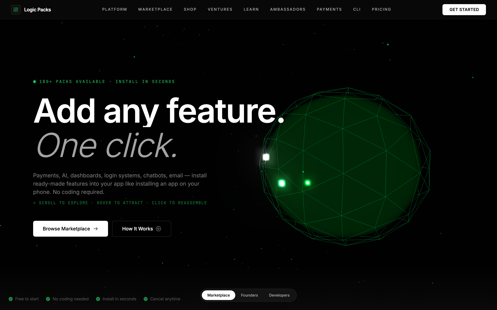
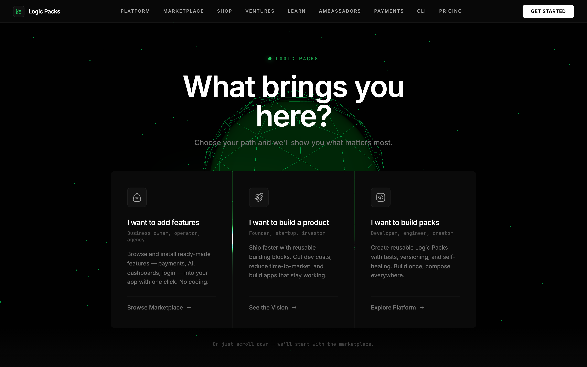
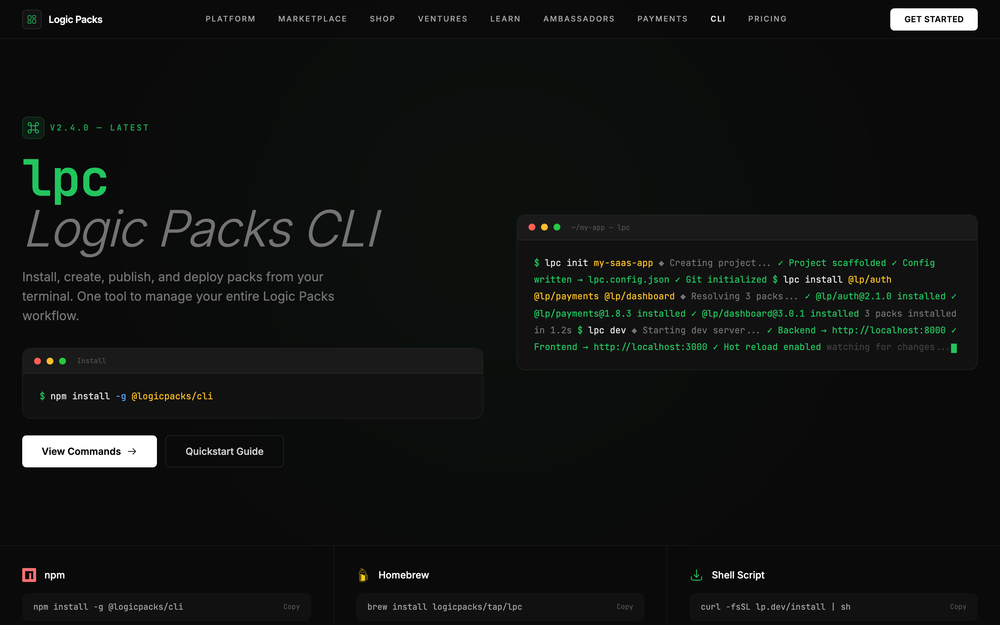
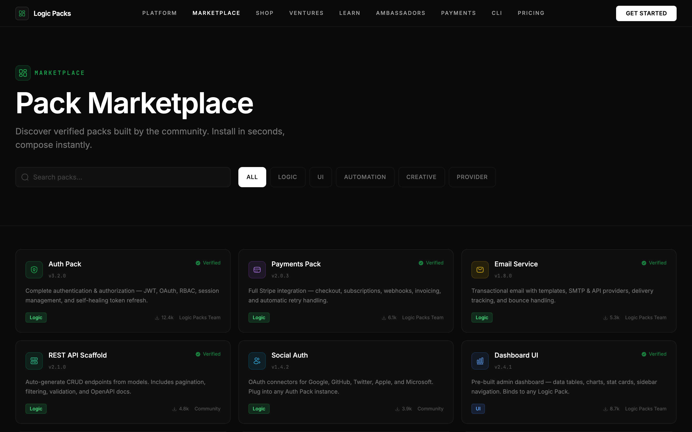
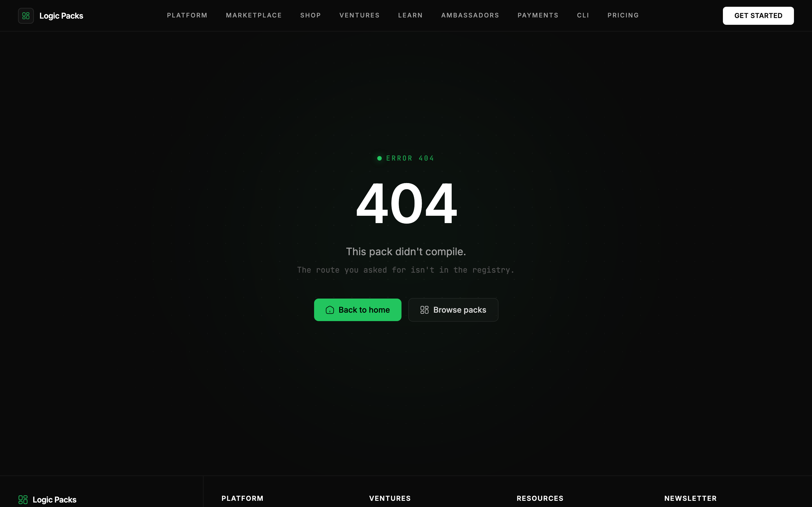
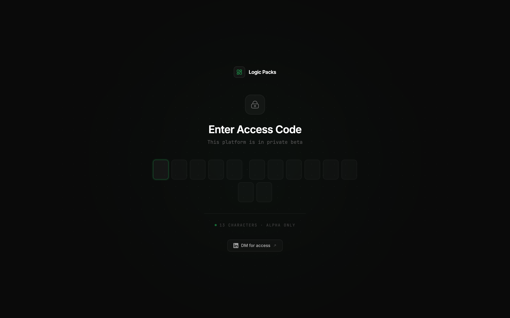

# Logic Packs — Build Once, Reuse Everywhere

> The operating system for reusable software. Browse a marketplace of verified feature
> **packs** — payments, auth, AI, dashboards, chatbots, email — and drop them into any app
> like installing an app on your phone. This repo is the **marketing + storefront landing
> site**: a fast, dark, motion-heavy React experience with a live Three.js hero.

<p align="center">
  
</p>

Built with React 18 + Vite, styled with Tailwind, animated with GSAP, and fronted by a
5,000-particle Three.js sphere that explodes on scroll and reassembles on click. No backend,
no database — every pack, product and price lives in typed data modules, so the whole thing
ships as static files and loads in a blink. Pack it up, ship it anywhere. 📦

---

## ✨ What's inside

- **Persona-aware home** — a "What brings you here?" chooser routes visitors to the view that
  matters to them: `marketplace` (buyers), `founder` (startups/VCs), or `developer` (pack
  builders). Each persona gets its own tailored landing page.
- **Live Three.js hero** — an icosahedron core + wireframe shell + particle field with bloom
  post-processing. Scroll to explode it, click to reassemble. It's the good kind of showing off.
- **A full storefront** — packs marketplace (`/store`), physical shop (`/shop`), pack &
  product detail pages, a CLI product page, plus audience pages for ventures, founders,
  investors, ambassadors and courses.
- **Private-beta access gate** — a slick 13-character code entry screen guards the site
  (see [Getting past the gate](#-getting-past-the-gate) below). Access is remembered per
  session.
- **Beta signup modal** — a global context (`useBeta()`) any component can pop open.
- **Custom 404** — unknown routes land on a themed "this pack didn't compile" page instead of
  a blank screen.
- **Genuinely responsive** — every page is tuned from 390px phones up to widescreen.

<p align="center">
  
  
</p>
<p align="center">
  
  
</p>

---

## 🚀 Quick start (from zero)

You'll need **Node.js 18 or newer** and npm (npm ships with Node). Not sure if you have it?

```bash
node -v   # should print v18.x.x or higher
npm -v    # any recent version is fine
```

Don't have Node? Grab the LTS installer from [nodejs.org](https://nodejs.org/), or use a
version manager like [nvm](https://github.com/nvm-sh/nvm).

Then, four copy-paste commands and you're live:

```bash
# 1. Clone it
git clone https://github.com/waleedsworld/logicpacks-landingpage.git
cd logicpacks-landingpage

# 2. Install dependencies
npm install

# 3. Start the dev server (opens http://localhost:3000 automatically)
npm run dev
```

That's it — you're running Logic Packs locally. 🎉

### Building for production

```bash
npm run build     # outputs an optimized static bundle to dist/
npm run preview   # serve that build locally to double-check it
```

The `dist/` folder is 100% static — drop it on any static host (Cloudflare Pages, Netlify,
Vercel, GitHub Pages, an S3 bucket, whatever you fancy).

---

## 🔐 Getting past the gate

The site opens on a private-beta access screen. The demo access code is:

```
buildanything
```

Type it into the 13 boxes (it auto-submits and plays a little unlock animation) and you're in.
Access is stored in `sessionStorage`, so it sticks until you close the tab. The code lives in
`src/components/AccessGate.jsx` if you want to change it or rip the gate out entirely.

<p align="center">
  
</p>

---

## 🧭 Project map

```
src/
├─ main.jsx              # entry — BrowserRouter + scroll reset
├─ App.jsx              # routes (lazy-loaded) wrapped in AccessGate + BetaProvider
├─ index.css            # design tokens, keyframes, shared utility classes
├─ components/
│  ├─ AccessGate.jsx    # private-beta code screen
│  ├─ HeroScene.jsx     # the Three.js sphere + particle explosion
│  ├─ BetaModal.jsx     # global beta-signup context + modal
│  ├─ Header / Footer / Layout / ScrollReveal / Terminal / ErrorBoundary
├─ pages/               # one file per route (Home, Store, Shop, CLI, Founders, …, NotFound)
└─ data/
   ├─ packs.js          # PACKS, TYPE_LABELS, TYPE_COLORS
   ├─ products.js       # PRODUCTS, PRODUCT_CATEGORIES
   └─ packDetails.js    # extended per-pack detail
```

**Routing at a glance:** `/` (persona chooser or `?view=` page), `/store`, `/pack/:slug`,
`/shop`, `/product/:slug`, `/cli`, `/ventures`, `/founders`, `/investors`, `/ambassadors`,
`/courses`, `/beta`, `/ambassador-apply`, `/payments`, and `*` → the custom 404.

### Design conventions

- **Background** `#0a0a0a` everywhere. **Accent** green-500 `#22c55e`.
- **Icons** are the [Solar](https://iconify.design/) linear set via `@iconify/react`.
- **Animations** — shared keyframes in `index.css`; GSAP for sequenced/page-level motion.
- Wrap sections in `<ScrollReveal>` for on-scroll entrance fades.

---

## 🛠️ Tech stack

| Layer      | Choice |
|------------|--------|
| Framework  | React 18 + Vite 6 |
| Styling    | Tailwind CSS v3 |
| Animation  | GSAP |
| 3D         | Three.js (+ EffectComposer bloom) |
| Routing    | React Router v6 |
| Icons      | `@iconify/react` (Solar set) |

Vite is configured to split Three.js, GSAP and React into their own cache-friendly chunks,
and every route is lazy-loaded — so tweaking a headline never re-downloads the 3D engine.

---

## 🌐 Live demo

**Deploying soon** — a hosted build is on the way. Until then, `npm run dev` gives you the full
experience in under a minute.

---

## 📄 License

Personal project by **Waleed Ajmal**. All rights reserved unless a `LICENSE` file says
otherwise. Feel free to read the code and learn from it. Build once, reuse everywhere. 💚
